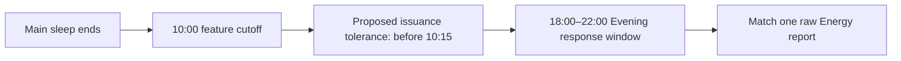

# AI-0 — Measurement and prediction contract

## Current collection policy — October 18, 2026

The user replaced the fixed clock schedule with flexible personal collection. New **Morning** check-ins collect **Energy only**, with no sleep entry. **Evening** check-ins retain all six optional ratings and link to a separate main-sleep log. Either period can be saved at any time; record the actual sleep and wake times. Earlier saved answers remain intact.

The current experimental path is **retrospective**, using `flexible-evening-retrospective-v1` in [the preparation tool](../tool/prepare_experimental_sleep_data.py). It has no 10 a.m. sleep deadline, morning snapshot requirement, or 6–10 p.m. response window. It still requires valid chronology: matched main sleep must end within 24 hours before the selected Evening response, and known save/import times cannot be after the export. Sleep may be logged after Energy; this does not establish a prospective prediction. Morning answers are not Evening targets.

The fixed schedule described below is **historical**. Existing saved plans keep their original meaning and remain reviewable under **Earlier fixed-schedule study**; the ordinary flow no longer starts them. Flexible experiment cohorts are versioned separately. The remainder records the earlier implementation and evidence at its stated date.

Draft ID: `tonyo-sleep-evening-energy-v0.3-draft`

Date: October 11, 2026; implementation status updated October 17, 2026

Status: **Timing, initial population, source defaults and English selected; remaining contract review is pending. AI-1 local study infrastructure and AI-2 assessment tooling are implemented. Modeling readiness is not established: no prospective participant data were inspected.**

The user selected fixed timing, their own data first, manual sleep by default with Apple Health selectable, and English on October 11, 2026, then authorized continuing the next step. On October 17 they requested completing AI-1 and AI-2 and selected “No / unsure — report readiness gaps” for existing prospective history. These choices authorize the local implementation and assessment below; they do not establish an empirical pilot, mentor approval or training permission. Other numerical settings and operational rules remain draft choices, not established scientific thresholds. See the [completion and readiness report](DATA_READINESS_REPORT.md).

## 1. Proposed first question

> At 10:00 on day D, using a recorded main sleep already available, can Tonyo predict the user's self-reported Energy between 18:00 and 22:00 that evening?

This predicts a later **report on the original 1–10 scale**. It does not estimate an objective biological quantity or a treatment effect. The sleep has already occurred when the prediction is made.

| Decision | Concrete draft | Decision status |
| --- | --- | --- |
| Primary target | Raw `energy`, integer 1–10, from one selected Evening self-report | Proposed, follows roadmap |
| Intended use | The user's own data first; future days for that same person | User-selected October 11, 2026 |
| Scheduled prediction / feature cutoff | 10:00 local time on day D | User-selected October 11, 2026 |
| Issuance window | First eligible app execution in `[10:00, 10:15)`; inputs still cut off at 10:00 | Proposed; handles unavailable background execution explicitly |
| Outcome window | 18:00–22:00 on day D; proposed exact interval `[18:00, 22:00)` in the event's frozen timezone | Hours user-selected October 11, 2026; endpoint/timezone rules proposed |
| Late responses | No grace for the primary target; retain late records separately | Proposed |
| Repeated submissions | First qualifying Evening submission, selected before inspecting Energy | Proposed |
| Input | One main-sleep duration in hours, with known pre-cutoff availability | Proposed |
| Sleep source | Manual default; Apple Health selectable as a separate source option | User-selected October 11, 2026; source isolation/versioning rules below proposed |
| Measurement/language | English (`en`), retaining the exact `tonyo-self-report-draft-v1` snapshot and full prompt context | English user-selected October 11, 2026; construct/wording review pending |
| Weekly questionnaire | None selected or approved; not required for this proposed target | Explicitly deferred |

The initial population is one person: the user, using their own data in English. Age eligibility and permission requirements remain to be recorded before real-data use under this protocol; the population choice alone is not data-use authorization. No age, consent or mentor approval is inferred. A personal feasibility exercise cannot establish transfer to other people. A later student pilot would require its own defined population and review. The selected clock times target a conventional overnight-sleep schedule; shift schedules or sleep ending after the morning cutoff need a separately specified timing variant.

## 2. Exact measurement under review

These are the **current English app definitions**, not revised wording:

| Property | Existing value |
| --- | --- |
| Shared form heading | “How do you feel right now?” |
| Item ID / label | `energy` / “Energy” |
| Item-specific prompt | Empty string; the shared heading supplies the question context |
| Response | Integer 1–10, initially unanswered |
| Anchor 1 | “extremely low energy” |
| Anchor 5 | “about average” |
| Anchor 10 | “extremely high energy” |
| Recall period | “right now” |
| Definition version / language | `tonyo-self-report-draft-v1` / `en` |
| Stored kind / status | `customSelfReport` / `draftNotClinicallyValidated` |
| Full item order | Energy, Fatigue, Sleepiness, Focus, Mood, Stress |

The proposed target is momentary Energy at the selected evening response, **not average Energy across the day**. Preserve the exact six-item definition snapshot and language; a version string alone is insufficient evidence of equal wording. The shared heading remains separate from the ordinary saved definition snapshot. When optional local history is enabled, the form now supplies its actual displayed heading alongside the full item definition; prospective dataset adapters must still match the approved presentation/recall contract.

The meaning of “about average” is unresolved: average compared with oneself, other people, or another reference is not specified. Whether Energy needs its own explicit prompt also needs review. Do not silently choose that meaning, rewrite old records, or declare the draft validated. Changed wording, anchors, recall period, ordering or language compatibility requires an explicit measurement-version decision.

All six answers remain optional in the app; saving still requires at least one answer. A supervised Energy example needs answered Energy, but an unanswered target remains a recorded missing opportunity. Fatigue, Sleepiness, Focus, Mood and Stress remain separate reports and are not inputs in this first experiment. Fatigue's overall/mental/physical interpretation remains a separate construct-review question.

The app supports English, Spanish, Simplified Chinese and Traditional Chinese. The user selected English for this first experiment; that choice does not establish translation equivalence or remove other app languages. Freeze the exact English definition and prompt context before evaluating results. No published questionnaire, weekly score or composite score is used as a daily Energy label.

Sources: [item definition](../lib/src/check_in_measurement.dart), [form](../lib/src/screens/daily_checkin_screen.dart), [translation catalog](../lib/src/l10n/measurement_translations.dart), [empty instrument catalog](../lib/src/questionnaire_framework.dart).

## 3. Timing and one daily opportunity

The selected outcome window is 8–12 hours after the scheduled prediction/cutoff; actual elapsed time since issuance is saved separately. The 15-minute issuance tolerance is a separate proposal and was not selected by the user's timing answer. All exact intervals in this draft are proposed as start-inclusive and end-exclusive unless explicitly stated otherwise; this includes excluding a response exactly at 22:00.

1. Define one opportunity per participant and local date D under this protocol. Before collection, prespecify the observation calendar and its timezone source, so unopened days still enter the opportunity count. Capture the IANA timezone and convert the cutoff, issuance deadline and outcome-window endpoints into UTC instants using that zone's calendar rules. Preserve both UTC instants and the event's local date/zone/offset metadata. An unknown day's timezone is an explicit coverage limitation, not a reason to drop the day silently.
2. The proposed mobile implementation issues at the first eligible execution in `[10:00, 10:15)`. Record the **actual** creation time. Every feature record and every source-selection dependency must have occurred and become available by the fixed 10:00 cutoff. A record arriving at 10:05 cannot enter a 10:12 issuance.
3. Durably save the immutable feature snapshot, cutoff, actual issuance time and source/definition versions before observing the target. AI-1 currently records feature snapshots with no numeric prediction or model identity. Its canonical opportunity identity combines protocol/source, local capture identity and date; per-date event identities and explicit conflicting-copy checks prevent counting retries as new opportunities. This is a single-issuing-device design. Separate device journals and export-local aliases cannot be merged as if cross-device uniqueness were established.
4. If no timely execution or durable save is possible, record `not_issued`/`missed_cutoff` when the opportunity is audited. Never generate a retroactive prediction and timestamp it as 10:00. Eligible opportunities and issued predictions have separate counts.
5. Keep the event's zone fixed. Do not reinterpret it using the device's later timezone, or derive tomorrow by adding 24 hours. Normal DST changes within the same IANA zone use calendar conversion. Ambiguous/nonexistent boundary instants or unknown timezone produce an explicit unavailable status. A detected timezone change between issuance and response excludes the primary pair for this first protocol; preserve its reason without changing the raw report.

The scheduling tolerance and travel exclusion are adjustable engineering proposals. Their costs in missed opportunities must be reported. No reliable exact-time background execution or travel detection is assumed to exist today.

## 4. Permitted earlier information

The candidate model receives only `main_sleep_duration_hours`. Source and availability metadata establish eligibility and support separate reporting; they are not extra predictors in this draft. Participant identity only binds records and any future personal model. Dates, schedules, language, current Energy/Cognitive scores and the five other ratings are not candidate features.

Proposed sleep policy:

The user selected **manual sleep as the default**, with **Apple Health as a selectable option**. This supersedes the earlier preference for Apple Health as default. The proposed implementation fixes one source per versioned experiment before its opportunities begin: no automatic fallback, merging or day-by-day switching. Changing the selected source requires a new protocol ID/versioned experiment. Records from the other source do not compete with the selected source or fill a missing selected-source record.

The subsequent request for automatic Apple Health syncing concerns the app's import behavior: after the person connects and permits access, available data is imported automatically. This does not change the manual default for this draft experiment or make late imports eligible for an earlier 10:00 cutoff. The app's existing manual/import preference rules remain separate from the experiment's fixed source selection.

1. Consider genuine main-sleep summaries ending on local date D in `[00:00, 10:00]` in the event's frozen timezone. A previous-day main sleep does not qualify as that morning's sleep. Exclude naps, synthetic/demo/model-generated records and malformed/nonfinite durations. Use the existing 0.5–16-hour software bounds as a provisional input sanity check, not a physiological normal range or study inclusion recommendation.
2. Observation time and **known availability to the prediction process** must both be at/before cutoff. For the proposed local implementation, this means available on the issuing device; an earlier save on another device or cloud receipt alone does not prove local availability. Imported, edited or manually entered records available later are excluded from this opportunity. Unknown availability remains unknown and cannot be substituted with sleep end time. For any source choice, freeze every record on which it depends.
3. Within the selected source, resolve each collection-scoped source identity to its latest revision demonstrably available by cutoff, then collapse identical copies of that revision. Ordinary successive edits are revisions; conflicting copies of the same revision abstain. If a pre-cutoff revision cannot be reconstructed, treat it as unavailable rather than borrowing the current value. Require one unambiguous main episode; multiple eligible main episodes within the selected source produce `ambiguous_sleep`. Do not select whichever duration improves the target fit.
4. Preserve manual versus Apple Health provenance and report each versioned experiment separately. Manual duration currently represents the entered bedtime-to-wake interval; it may include awake time. Health summaries have different measurement semantics. Supporting both source options does not make their measurements interchangeable; do not silently calibrate or pool them.
5. A missing actual bedtime stays missing. Do not subtract duration from sleep end to invent a start time. No sleep-stage preference, quality score, naps, full-day total or previous-day date shift is added to the candidate feature.
6. Without an eligible sleep record, record `no_eligible_sleep` and issue no primary candidate prediction. A separate comparison baseline may have different coverage; retain the shared-day comparison and each method's total coverage separately.

This policy deliberately does not reuse the current retrospective sleep/report join: that join anchors to the response and may use evidence available only when exporting. Later sleep edits cannot change an issued feature snapshot. Any permitted reanalysis must be separately identified; deletion/withdrawal must propagate to derived copies rather than being overridden by immutability.

## 5. Exact primary outcome matching

Only genuine, valid, compatible `selfReport` submissions explicitly marked `Evening` can qualify. Both observation time and the **initial durable save time** must lie in `[18:00, 22:00)` on opportunity day D. The report must have compatible captured date/timezone metadata and match the frozen measurement definition/language. For a candidate prediction–target pair, it must also follow that candidate's actual issuance. Outcome completion is audited for all opportunities, including those with no candidate prediction; `not_issued` and `no_response_in_window` are separate facts. A future baseline has its own issuance/coverage record. Do not infer Evening from the clock or backdate a later entry.

Order qualifying original submissions by observation instant, then initial durable save instant, then stable source ID. Select the first **before reading its Energy value**. Equal-identity conflicting original snapshots are an ambiguity, not a tie resolved by a rating. Never match the answer nearest the prediction.

- Selected Energy present and integer 1–10: use that raw number; do not convert it to the legacy 0–100 score.
- Selected Energy missing: `missing_energy`; do not fall back to a later answered submission or another measure.
- No qualifying submission: `no_response_in_window`; keep late, Morning, incompatible and malformed responses separately with reasons.
- A selected response corrected in its ratings/period/definition by the analysis as-of instant: flag `selected_response_revised` and exclude that target from the primary set under this proposed correction policy. Do not replace it with another submission. The initial snapshot and any revision lineage needed to audit this must have been captured prospectively, subject to deletion rights. Notes are not analysis data.
- Deletion or withdrawal: invalidate/remove affected targets and derived snapshots under the local data-lifecycle design. Relevant tombstones conservatively invalidate the corresponding whole-plan lineage until clear/restart. Never resurrect an old answer from the audit copy or promote another submission into its place for training.

Every analysis/export must record its as-of instant and dataset version. A later ordinary edit requires a new analysis version; it cannot silently change the frozen version's results. Deletion and withdrawal still propagate to stored data and derived copies even after a freeze. If lineage or revision availability is uncertain at the freeze, the target is unavailable. Exact freeze dates belong to the subsequent data/evaluation plan.

The current mutable `recordedAt` cannot prove the initial save time after an edit. Existing exports without initial-revision evidence may support explicitly retrospective descriptions; they cannot be presented as prospective examples under this contract.

An in-window response durably saved on the device may be uploaded later without becoming a late response, provided its original snapshot and initial local availability are retained. An observation made or first durably saved after 22:00 is late. A network receipt time alone cannot distinguish these cases.

### Worked acceptance examples for AI-1

All examples below are invented software fixtures in the event's timezone.

| Situation | Required result under this draft |
| --- | --- |
| Sleep ends 07:00, saved 08:00; event saved 10:03; compatible Evening Energy 7 saved 19:00 | Feature eligible, target 7 |
| Same sleep first imported 10:05; app executes 10:12 | Sleep unavailable at cutoff; no primary prediction |
| Sleep saved 08:00, corrected 13:00 | Original issued feature snapshot stays unchanged; correction is separate |
| App first executes 10:15 or 11:00 | Missed issuance window; no fabricated morning prediction |
| First qualifying 18:30 response has only Focus; 20:00 response includes Energy 8 | `missing_energy`; no fallback to 8 |
| Energy response saved exactly 18:00 / exactly 22:00 | First may qualify; second is outside the window |
| Response observed 21:59 but first saved 22:01 | Late; no primary target |
| First Energy 7 is edited later to 4 | Mark selected target revised; neither silently replace nor select a later response |
| Manual selected; both manual and Apple Health summaries are present | Consider manual only; preserve source provenance |
| Manual selected; only Apple Health has an eligible summary | `no_eligible_sleep`; no automatic fallback |
| Two eligible main episodes remain within the selected source | `ambiguous_sleep`; raw records retained |
| Participant changes IANA timezone between issuance and response | Primary pair excluded with travel reason; frozen event times retained |
| Same opportunity appears twice after retry or on another device | At most one issued primary event; conflicts are explicit |
| Synthetic records, withdrawn data or unknown availability | No real-data training/evaluation example |

## 6. Implemented AI-1 infrastructure and AI-2 assessment

The October 17 implementation completes the local infrastructure around the existing [protocol/calendar rules](../lib/src/ai1_protocol.dart), [immutable records](../lib/src/ai1_records.dart) and [dataset builder](../lib/src/ai1_dataset_builder.dart). The [study adapter](../lib/src/ai1_study.dart) connects the protected journal to a prespecified calendar, frozen morning snapshots, closed-day outcome matching and a private export. The [AI-2 evaluator](../lib/src/ai2_readiness.dart) reports coverage, missingness, lateness, Energy distributions and explicit review gaps. The [data dictionary](AI1_DATA_DICTIONARY.md) specifies exact schemas; the [readiness report](DATA_READINESS_REPORT.md) records verification and the no-real-data conclusion.

**Privacy center → Local study history → Keep local study history** remains off by default. After enablement, new manual sleep saves and versioned self-report saves retain immutable revisions, exact wording and displayed heading. Notes are excluded. Editing an older uncaptured record never establishes original-submission provenance; existing app records, cloud hydration and backups are not backfilled.

**Study tools → Start tomorrow’s plan** separately creates a future calendar with a fixed IANA timezone and one source, manual by default or Apple Health. The 1–366-day UI range and default 28 days are scheduling controls, not a statistical sufficiency rule. The plan must have a durable receipt before its first day. Closed windows include unopened dates. Changing source/calendar requires clearing history and starting a new plan.

Foreground execution checks each minute and refreshes the device timezone. A first eligible execution in `[10:00, 10:15)` saves the morning feature snapshot; both its creation and durable receipt must be in the window. Selection remains cut off at 10:00. No late execution creates a backdated snapshot. Detected timezone mismatch records a marker and stops subsequent snapshots until clear/restart. There is no guaranteed OS background schedule or continuous travel detection.

For Apple Health, successful readable sleep query batches are retained before ordinary app source reconciliation. Study episode selection preserves competing-source evidence and does not borrow the app's preferred summary or fill missing Health data with manual sleep. Missing-sample comparisons use sample start times within the recent 29 elapsed days, safely inside the native rolling 30-calendar-day query boundary. This does not prove complete read authorization or detect all older external changes. Known older changes require explicit history clearing. Exported Health feature lineage links the selected query and episode without exposing original sample/producer IDs.

The protected, backup-excluded native journal remains separate from app preferences/cloud state. An atomic payload write/flush returns its native completion time; a second write persists that receipt. Missing/interrupted receipts, corrupt history and backward clocks cannot establish availability. The 4 MiB/4,000-revision bounds do not silently trim data. Source erasure removes retained payloads and derived events; relevant tombstones conservatively invalidate the corresponding whole-plan sleep/response lineage. Queued Health erasure and owner/generation checks prevent pending capture from recreating erased evidence. Disablement/reset/account deletion clear applicable history; sign-out unloads the owner. Physical-device protected-file, backup-exclusion and power-loss acceptance remain separate from software tests.

**Assess local readiness** is an explicit read-only aggregate view. **Save private study export** separately confirms and saves `tonyo-study-export-v1` through the native file picker. The export includes raw revisions, closed-opportunity rows, aliased Health queries, plan/deletion/timezone provenance, exact measurement context and `ai2-measurement-readiness-v1`. It is excluded from ordinary backups, exports and cloud sync. Choose an on-device destination to keep the file local; the system picker can offer cloud folders. The app does not copy this export to the clipboard or upload it. Saved/shared files require separate deletion by their holder.

The implementation retains `trainingEligible: false`; AI-2 retains `modelingReady: false` and `trainingAllowed: false`. No numeric prediction, fitted model or performance result is produced. The new-measurement form still states that its answers are not used to train models; optional legacy-outcome consent does not override it. Training requires separately reviewed participant-facing scope and explicit data-use authorization.

The synthetic four-day audit remains available through `dart run tool/ai1_synthetic_audit.dart` and `--apple-health`. It reads no app data and exercises a valid pair, late sleep availability, unanswered first Energy response and an unopened day. Synthetic and captured inputs are separate builder paths. Synthetic results verify software only; no real participant data were inspected or enabled during this work. AI-2 is complete as an implemented assessment and evidence-gap report, not as an empirical pilot or authorization for real-data AI-3 modeling. Separate [AI-3 synthetic preparation](AI3_SYNTHETIC_PREPARATION.md) now exercises B0/B1/M1 comparisons on invented records; it accepts no private files and activates no app model.

## 7. Evaluation boundary

The intended first claim is prediction on later days for the same person. It is not new-person transfer. Exact collection duration, minimum usable history and split dates remain to be planned before modeling; the legacy model's 14-day/30-day/5% gates do not become thresholds for this experiment.

Proposed primary error unit is absolute error in original 1–10 rating points. Keep missing targets out of error calculations and report issued/eligible/matched counts and exclusion reasons alongside errors. Freeze chronological development/validation/test partitions before model comparison. Fit any preprocessing or personal-history baseline only with information available in its training/prediction past. The real-data candidate's exact output type, baselines, search budget, acceptance threshold, uncertainty method and untouched-test policy belong to subsequent modeling/evaluation stages and remain undecided here. The synthetic runner's fixed clipping/history/numerical rules are software-test policies, not approval of those empirical decisions.

No accuracy, sample-size sufficiency or clinical claim follows from this document or the passing app tests. No algorithm has been selected by AI-0.

The later [pre-data preparation](PRE_DATA_PREPARATION_REPORT.md) rehearses frozen synthetic evaluation, F1 feature compatibility, simulated shadow execution and strict model-artifact/lifecycle behavior. AI-4's single frozen fit is distinct from AI-3's expanding replay. The [AI-5 plan](AI5_FEATURE_EXPERIMENT_PLAN.md) keeps extra features unimplemented/deferred, and uncertainty remains explicitly unestimated pending a suitable plan. A typed evidence audit records missing review/real-data/device evidence but cannot grant training or release permission; it changes no ordinary app-entry flow. These preparations do not fill the decision record below or change this contract from `v0.3-draft`.

## 8. Decision record and exit check

| Record | Current state |
| --- | --- |
| Authority to start AI-0 | User request on October 11, 2026 |
| Timing preference (`AI0-D001`) | User-selected October 11, 2026: “Fixed times: predict at 10 am; evening rating 6–10 pm (Recommended)” |
| Initial population (`AI0-D002`) | User-selected October 11, 2026: “My own data first (Recommended)”; personal feasibility, no age inferred |
| Source defaults (`AI0-D003`) | User-selected October 11, 2026: manual default, Apple Health selectable; supersedes the earlier Apple Health default preference. Isolation/versioning rules remain proposed |
| Experiment language (`AI0-D004`) | English selected October 11, 2026; exact construct/wording review remains pending |
| Measurement/construct review | Pending; Dr. Lin is a suggested reviewer in the roadmap, not a recorded approval |
| Timing/data implementation review | Pending; Dr. Sun is a suggested reviewer in the roadmap, not a recorded approval |
| Actual reviewer / decision date / reference | Not supplied |
| Questionnaire | None selected or approved; deliberately outside primary target |
| Research/data-use authorization | Not established by this draft |
| AI-1 local implementation | User requested completion October 17, 2026; local calendar, snapshot, manual/Health lineage, dataset adapter and private export implemented; verification in [report](DATA_READINESS_REPORT.md) |
| AI-2 readiness assessment | Tooling and evidence-gap report complete; prospective measurements not inspected, empirical modeling readiness not established |
| Real prospective collection, training or release activation | Not performed during implementation; user history setting remains untouched and study tools remain opt-in |

AI-0 can be accepted once the remaining target/wording, exact timing, source isolation/versioning, matching/edit and questionnaire decisions are agreed and recorded. Construct meaning, including “about average,” remains open. Pending review does not prevent the user-authorized reversible local work with synthetic fixtures. Real-data collection has separate review/permission prerequisites. Update this contract before the experiment uses results to choose rules.

| Version | Change | Status |
| --- | --- | --- |
| `v0.1-draft`, October 11, 2026 | First concrete AI-0 proposal, grounded in current app definitions; operational timing, missingness, revision and availability examples | Proposed; acceptance pending |
| `v0.2-draft`, October 11, 2026 | Recorded the user's fixed 10:00 / 18:00–22:00 timing choice and own-data-first population; separated those choices from proposed issuance tolerance and interval rules | Two decisions recorded; remaining contract review pending |
| Implementation update, October 17, 2026; contract remains `v0.3-draft` | Added AI-1 local infrastructure and AI-2 evidence-gap assessment; no scientific settings promoted to approved status | Software implementation; remaining contract review and real-data readiness unresolved |
| `v0.3-draft`, October 11, 2026 | Recorded manual default with selectable Apple Health (`AI0-D003`), English (`AI0-D004`) and authorization for the first synthetic-only AI-1 slice; proposed source isolation and versioning | Four user decisions recorded; remaining contract review pending; local AI-1 started |

Roadmap authority: [AI-0](../TONYO_BIOLOGY_AND_AI_ROADMAP_v2.md#20-ai-0-agree-on-the-measurement-and-prediction-contract), [AI-1](../TONYO_BIOLOGY_AND_AI_ROADMAP_v2.md#21-ai-1-build-a-trustworthy-analysis-dataset), and [undecided experiment settings](../TONYO_BIOLOGY_AND_AI_ROADMAP_v2.md#29-adjustable-experiment-settings).
