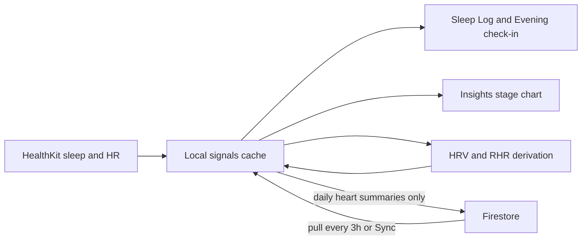

# Device sleep, Insights stages, and Firestore usage fixes

Overview: Fix Apple Watch/Oura sleep so it counts as real sleep records, surface sleep stages in Forecast Insights, cut Firestore usage by keeping raw heart rate local and syncing daily averages on a throttled cloud cadence, and derive HRV/resting HR from sparse Oura heart-rate samples when Apple Health lacks native values.

## Work items

- **sleep-as-records** — Include healthkit-sleep groups in sleepLogs; evening check-in shows device sleep as logged/reviewable
- **insights-stages** — Aggregate preferred-night stage hours in InsightsLogic and chart Core/Deep/REM/Awake in Insights UI
- **firestore-throttle** — Coordinate with coworker sync/DB work: keep their summaries/serialization changes; only add gaps (raw HR exclude, poll/TTL throttle, prune) they missed
- **oura-derivation** — Add HeartDerivationLogic for resting HR + sparse HRV proxy; Profile tip when samples insufficient

## Coordination (do not overwrite)

A coworker is already fixing **sync issues**, **database read/write volume**, **summaries**, and **data serialization**. When implementing this plan:

- **Keep their work.** Do not revert, rewrite, or parallel-replace their sync/serialization/summary approach.
- Inspect what they landed (or have in progress) first for cloud hydrate, patches, daily summaries, and local vs cloud serialization.
- For §3 only, **add gaps they missed**—e.g. raw `heartRate` still uploading, 1-minute poll still pushing every commit, missing pull TTL, Insights still querying dense HR, or prune of existing cloud HR docs.
- Prefer extending their helpers/collections over inventing a second summary path.
- Sleep records (§1), Insights stages (§2), and Oura derivation (§4) remain owned by this plan unless the coworker’s branch already covers them.

## Defaults (from device testing report)

- Device-imported main sleep **is** a sleep record for check-in / Sleep Log (not a parallel track).
- Raw `heartRate` samples stay **on device only**; cloud gets **once-daily averages** (avg HR, HRV, resting). Existing cloud raw `heartRate` docs are **pruned** (only if coworker did not already do this).
- Cloud hydrate runs about every **3 hours** (or on explicit Sync / sign-in), not on every resume—**align with coworker’s cadence if they already chose one**.
- Derived Oura HRV/RHR are clearly labeled estimates, never presented as Apple SDNN.

---

## 1. Device sleep as actual sleep records

**Root cause:** HealthKit nights already become `SignalType.sleep` under `healthkit-sleep-*` and power Today (“last recorded sleep”), but [`sleepLogs`](lib/src/app_controller.dart) only includes groups starting with `sleep-`. Evening check-in seeds from `sleepLogs` only ([`daily_checkin_screen.dart`](lib/src/screens/daily_checkin_screen.dart) `_openSleep`), so users still see “Log or review sleep” as empty.

**Change:**

- Extend `sleepLogs` to also map preferred `healthkit-sleep-*` (and nap) groups that already have a summary `sleep`/`nap` (+ bedtime for main) into `SleepLogEntry`, same shape as manual entries.
- Update Evening sleep card copy/state: if a preferred main sleep exists in the last 24h, show **duration + source** and CTA **“Review sleep”** instead of implying nothing is logged.
- Keep edit behavior: reviewing a Health night can open Sleep Log prefilled; saving a manual correction continues to use existing `SleepSyncLogic` preference (80%/50% staging gate when both exist).
- Do **not** duplicate Health nights into new `sleep-*` IDs (would risk double-counting). One list, two groupId prefixes.
- Touch callers that assume only `sleep-` IDs for delete/edit ([`deleteSleepLog`](lib/src/app_controller.dart), Daily History) so Health-backed entries are reviewable and deletable safely (delete removes that group’s signals).

**Tests:** unit coverage that a `healthkit-sleep-*` summary appears in `sleepLogs` and seeds the evening card; manual + Health preference still follows existing merge rules.

---

## 2. Sleep stages in Forecast → Insights

**Root cause:** Stages (`sleepAwake` / `sleepCore` / `sleepDeep` / `sleepRem`) are already written by [`SleepSyncLogic`](lib/src/sleep_sync_logic.dart); Insights only charts total main-sleep hours ([`insights_logic.dart`](lib/src/insights_logic.dart) / [`insights_screen.dart`](lib/src/screens/insights_screen.dart)).

**Change:**

- Add per-day stage hours on `InsightDay` (and period averages) by summing sibling stage readings on the preferred main-sleep `groupId`.
- UI: new Insights section under daily trends — stacked bar (or equivalent) for Core / Deep / REM / Awake per night; hide nights with no stage data (manual-only).
- Overview: optional “Avg deep / REM” beside avg main sleep when any staged nights exist in the window.
- No new sync or SignalTypes; scoring stays duration-based.

**Tests:** `insights_logic` with a Health-style grouped night; widget smoke that the section appears when stages exist.

---

## 3. Cut Firestore reads/writes (gap-fill only — coworker owns core sync)

**Ownership:** Coworker leads sync fixes, summaries, and data serialization. This section is a **checklist of intended outcomes**. Implement only what their branch has not already covered; wire Oura-derived values (§4) into *their* daily summary path if one exists.

**Main cost drivers today (verify against their changes before redoing):**

- Foreground Health poll every **1 minute** ([`ContinuousRefreshLogic.foregroundRefreshInterval`](lib/src/continuous_refresh_logic.dart)) → `_commit` → `_pushCloud`, including user-root `healthSync` metadata even with 0 new samples.
- Every ordinary `heartRate` sample = one `signals/{id}` doc; full-collection `readUser` on hydrate ([`firebase_services.dart`](lib/src/firebase_services.dart)); Insights 56-day range includes dense HR.

**Target outcomes (add only if missing after their work):**

| Layer | Behavior |
|-------|----------|
| Local Health poll | Keep importing HR/HRV/RHR/sleep into memory + SharedPreferences; raise foreground Health check to **15 minutes** if still 1 minute (still refresh on open if due). |
| Cloud exclude | Omit `SignalType.heartRate` from sync snapshots/patches so raw bpm never uploads. |
| Daily push | Once per local day, upsert heart summaries (`avgHeartRate`, `avgHrv`, `restingHeartRate`, counts/provenance)—**use coworker’s summary collection/schema**; do not invent a second one. Prefer native HRV/RHR; else derived from §4. |
| healthSync metadata | Prefer local attempt timestamps; avoid per-minute root cloud writes if still happening. |
| Cloud pull | Throttle full hydrate (e.g. ~3h TTL) unless coworker already set a cadence; exceptions: first sign-in, Retry sync, conflict review. |
| Range queries | Exclude raw `heartRate` from Insights/score cloud lookbacks if still included. |
| Prune | Delete existing cloud `signals` with `type == heartRate` if not already pruned. Keep local samples. |

**Files (likely touch only gaps):** [`app_controller.dart`](lib/src/app_controller.dart), [`cloud_sync.dart`](lib/src/cloud_sync.dart), [`firebase_services.dart`](lib/src/firebase_services.dart), [`continuous_refresh_logic.dart`](lib/src/continuous_refresh_logic.dart), plus whatever summary/serialization modules the coworker added.

**Tests:** Only for net-new gap behavior; reuse/extend their sync tests instead of duplicating.

---

## 4. Oura / non-Watch HRV and resting HR derivation

**Context:** Oura writes ordinary HR into Apple Health (~30 min); Apple often has **no** native HRV SDNN / resting HR without Apple Watch. No Oura API integration exists—use HealthKit `heartRate` only.

**New module** (e.g. `heart_derivation_logic.dart`), run after [`HeartSyncLogic.merge`](lib/src/heart_sync_logic.dart) in the health sync path:

**Resting HR (simple):** For each local day, take overnight/early-morning HR samples (e.g. 00:00–08:00 local, or lowest sustained window). Estimate resting as **minimum of a short rolling median**, or **10th percentile** if ≥ N samples; require at least **3** samples. Write `SignalType.restingHeartRate` with id prefix `derived-hr-…`, `note` like `Estimated from heart rate · Apple Health · Oura` (or source name from sample note), lower `quality` than native.

**HRV proxy (simple, sparse-aware):** True SDNN needs beat-to-beat data. With 30-minute samples:

- If a day has **≥ 6** daytime HR samples spaced ≤ ~45 min, compute a **coarse RMSSD-like proxy on successive HR differences** (scaled/clamped to a plausible ms band) and label clearly as **estimated HRV from heart rate**, not SDNN.
- If samples are too few/sparse: **do not invent a number**; surface Profile / health-sync guidance: *“For a better HRV estimate, open the Oura app and take a heart-rate reading, then Sync now in Tonyo.”*

**Conflict rules:** Never overwrite an existing same-day **native** HealthKit HRV/RHR (UUID `healthkit-…`). Derived values fill gaps only. Baselines/engine already consume `hrv` / `restingHeartRate` types—no engine rewrite beyond quality/provenance awareness if needed.

**UX:** Profile Apple Health card shows latest derived vs native and the sparse-data tip when derivation skipped.

**Tests:** synthetic sparse Oura-like series → RHR; dense enough series → estimated HRV; too sparse → no HRV + reason; native present → derived skipped.

---

## Implementation order

1. Sleep logs + evening check-in (user-facing bug).
2. Insights stage visualization (data already present).
3. Review coworker sync/summary/serialization work; **gap-fill only** for remaining read/write cost (do not replace their approach).
4. Heart derivation for Oura gaps (hook into their local HR + daily summary path when present).

## Out of scope

- Oura Cloud API / OAuth.
- Changing fatigue score weights to use sleep stages.
- AI-1 study source exclusivity (manual vs Health) unless you later ask to unify study capture.
