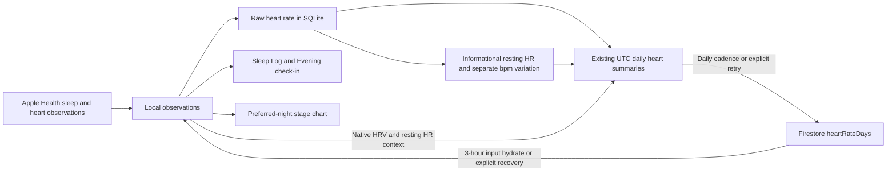

# Device sleep, Insights stages, and Firestore usage fixes

Implementation status: the four work items below are implemented and regression-verified. Updated backend rules and indexes are deployed and independently verified. The signed native release is installed and running on Harry's iPhone; launch and process-restart data-preservation checks pass. Live cloud acknowledgement remains pending the existing Firebase quota restriction.

The existing sync, SQLite, serialization, daily summary, incremental input, forecast, and quota work is preserved. These changes extend that implementation.

## Approved behavior

- Device-imported main sleep is a sleep record for Sleep Log, Evening check-in, and Daily History.
- Imported raw heart-rate samples stay on the iPhone in SQLite. The existing cloud summary collection stores descriptive daily aggregates.
- Automatic Health polling uses a 15-minute interval. Automatic cloud input hydration uses a 3-hour interval, with explicit recovery and account initialization paths available immediately.
- Automatic heart-summary uploads run once per local calendar day when changed data is available. Explicit Health **Sync now** and cloud **Retry sync** bypass that cadence; unchanged summaries still produce no writes.
- **Approved adjustment:** sampled heart-rate variation is a separate **bpm** metric. It is not an HRV proxy, is never converted to milliseconds, and does not affect scoring. HRV remains native imported HRV; missing beat-to-beat evidence stays missing.
- Estimated resting HR is clearly labeled and informational. It is excluded from measured baselines, score inputs, and ML preparation.

## 1. Device sleep as actual sleep records — implemented

[`sleepLogs`](lib/src/app_controller.dart) now selects records using the existing `SleepSyncLogic.preferredSleepReadings` and `preferredNapReadings` rules. It maps manual `sleep-*`, imported `healthkit-sleep-*`, and imported `healthkit-nap-*` groups to `SleepLogEntry`. Main sleep still requires its summary and bedtime; stage-only and incomplete imported groups do not become empty records.

[`SleepLogEntry`](lib/src/models.dart) retains source and recorded sleep duration. Device sleep duration excludes awake time and is not replaced with the full bedtime-to-wake span.

- The Evening card shows **duration · source · Saved** and **Review sleep** when a preferred main sleep ended within the preceding 24 hours. Review opens the saved times; stale and future records do not seed the form.
- Listing a device night never copies its signals into a manual group. An explicit manual correction uses a stable correction ID, preserves the imported group and stages, and continues to use the existing 80% duration / 50% detailed-stage preference gate. Repeated saves do not create additional corrections.
- [`DailyHistoryLogic`](lib/src/daily_history_logic.dart) shows the preferred semantic record once, without duplicate stage or summary rows. Imported sleep is reviewable and deletable while retaining its source label.
- `deleteSleepLog` removes the selected group's signals, including stage siblings. The deletion confirmation explains that Apple Health originals remain and may be imported again later.
- Imported data confidence is not displayed as a subjective quality rating in history. New presentation copy has Spanish, Simplified Chinese, and Traditional Chinese translations.

Coverage: [`device_sleep_records_test.dart`](test/device_sleep_records_test.dart), existing sleep form/connection tests, check-in widgets, Daily History, and sleep/nap preference tests.

## 2. Sleep stages in Forecast → Insights — implemented

[`InsightsLogic`](lib/src/insights_logic.dart) sums Core, Deep, REM, and Awake siblings belonging to the preferred main-sleep group for each wake date. Competing nights and naps do not contribute to that night's stages.

[`InsightsScreen`](lib/src/screens/insights_screen.dart) includes a stacked stage display beneath the daily trends and average Deep/REM values when staged nights exist. Nights with no stage data are hidden from the stage chart. Missing stages remain unknown, not zero; each stage average uses nights where that stage was recorded. Awake time stays separate from asleep duration.

No new sleep SignalTypes or sync collections were introduced. Sleep stages remain descriptive and do not change score weights.

Coverage: [`insights_logic_test.dart`](test/insights_logic_test.dart) and [`insights_phase1_widget_test.dart`](test/insights_phase1_widget_test.dart), including preference, missingness, stage aggregation, and responsive presentation.

## 3. Firestore reads and writes — implemented by extending existing sync

| Layer | Implemented behavior |
|-------|----------------------|
| Local raw storage | Imported ordinary HealthKit heart-rate observations stay in the existing owner-scoped SQLite store. The durable raw snapshot is saved before compact preferences and cloud summaries. Sparse inputs remain in the existing local state. |
| Cloud input patches | Imported raw HealthKit `heartRate` readings are excluded from ordinary snapshots and patches. Existing manual inputs and native HRV/resting HR records retain their original semantics. |
| Summary collection | The existing `heartRateDays/{YYYY-MM-DD}` documents retain **UTC day IDs**, raw sample counts/digests, total and hourly aggregates, exact latest observation, timezone provenance, and writer ownership. No parallel summary collection was added. |
| Cardiac context | Version 2 extends those documents with `cardiacContext`: native HRV mean/count/source in ms, native resting HR mean/count/source in bpm (otherwise the explicitly estimated resting value), and separate sampled-bpm variation with counts, method, interval, and provenance when supported. Native and estimated resting HR are never mixed into one mean. |
| Compatibility | Version 1 summaries remain readable. Version 2 includes a separate raw-content digest and a digest covering cardiac context. Average HR continues to come from the existing sum/count aggregates. Related sparse observations remain individually recoverable; summary averages are not substituted for model evidence. |
| Daily upload cadence | Changed summaries are automatically eligible once per **local calendar day**, independently of their UTC document grouping. Successful-upload metadata persists across restart. Explicit Health Sync now, cloud Retry sync, and relevant explicit deletion paths can bypass deferral. |
| Health polling | `ContinuousRefreshLogic.foregroundRefreshInterval` is 15 minutes; open/resume refreshes when due. Native change callbacks and daily/full-history reads retain their established behavior. |
| Local diagnostics | `lastHealthSync` and the `healthSync` diagnostic map are excluded from ordinary cloud input snapshots and restored baselines. Repeated unchanged imports persist attempts locally without root patches. Hydration preserves the current device's status and active observer registration. |
| Cloud input reads | Automatic resume hydration is throttled to 3 hours using owner-scoped persisted metadata. The existing revision cursor, incremental journal, cached input snapshots, and explicit sign-in/recovery paths remain in use. |
| Derived lookbacks | Score, forecast, Coach, and Insights cloud reads continue to exclude dense ordinary heart-rate history. Exact raw observations remain available locally. |
| Legacy raw pruning | Existing proof-gated cleanup is retained: preserve the raw sample locally, verify an acknowledged complete summary against the durable snapshot, then issue conflict-aware legacy raw deletions. A quota failure, ownership conflict, digest mismatch, or concurrent edit retains the unverified records. Explicit user deletion remains a separate intentional removal path. |
| Quota and forecasts | Existing quota cooldown/recovery and packed daily forecast documents remain intact. Summary cadence does not weaken writer ownership, compare-and-replace, or retry safety. |

Summary construction reads committed SQLite and persisted sparse inputs, so an in-flight edit cannot be uploaded ahead of its local save. Unknown legacy timezone provenance is not invented for the sampled-bpm context. Overlapping summaries from separate devices are never added together.

Key implementation: [`efficient_sync.dart`](lib/src/efficient_sync.dart), [`cloud_sync.dart`](lib/src/cloud_sync.dart), [`heart_rate_summary.dart`](lib/src/heart_rate_summary.dart), [`raw_heart_rate_store.dart`](lib/src/raw_heart_rate_store.dart), and [`continuous_refresh_logic.dart`](lib/src/continuous_refresh_logic.dart).

Coverage extends the existing summary, cloud-store, controller migration, quota, and input-sync tests. [`health_sync_metadata_test.dart`](test/health_sync_metadata_test.dart) checks unchanged polling, legacy-journal normalization, and device-state preservation during hydration.

## 4. Oura / other Apple Health heart data — implemented with separate bpm variation

[`HeartDerivationLogic`](lib/src/heart_derivation_logic.dart) reconciles available imported heart observations after the normal heart merge. It never creates `SignalType.hrv` from ordinary bpm samples.

### Informational resting HR

- Use distinct overnight observations from midnight to 08:00 on each local day; require at least three samples.
- Estimate the minimum median across consecutive three-sample windows.
- Store a stable `derived-hr-resting-*` record with `SignalSource.model`, reduced quality capped at 0.5, and an explicit estimate/source note.
- Preserve valid same-day native or manually logged resting HR. Native data replaces a prior inferred fallback; unchanged estimates retain their recorded-at timestamp.
- Keep estimates out of measured personal baselines, current score physiology inputs, and ML preparation. A summary-only restore does not erase an estimate simply because the receiving phone lacks its raw source data.

### Separate sampled heart-rate variation

The user selected a separate bpm variation metric. The implementation computes the root-mean-square of successive **bpm differences**, without converting to ms or labeling it SDNN/RMSSD/HRV.

Each eligible daytime run must contain at least six distinct samples over at least two hours, with gaps no greater than 45 minutes. Pairs across gaps or local calendar dates are excluded. Insufficient evidence produces no value. This statistic is descriptive only and is not a score, baseline, or training input.

### Profile presentation

[`HeartDataDetails`](lib/src/widgets/heart_data_details.dart) distinguishes native HRV, native/logged/estimated resting HR, and sampled heart-rate variation. It shows measurement dates and explains why an estimate or variation is missing. Missing HRV guidance explains that ordinary heart-rate observations cannot supply beat-to-beat intervals; taking another ordinary heart-rate reading is not presented as a way to obtain HRV.

Coverage: [`heart_derivation_logic_test.dart`](test/heart_derivation_logic_test.dart), [`heart_data_details_test.dart`](test/heart_data_details_test.dart), existing personal-baseline/score/ML tests, and the cardiac-context summary tests.

## Validation and rollout status

- [x] Sleep records, Evening review state, safe group deletion, and source-aware history implemented.
- [x] Preferred-night Insights stage aggregation and presentation implemented.
- [x] Existing SQLite/summary sync extended with cardiac context, polling/pull throttles, daily upload cadence, and local diagnostics.
- [x] Informational resting HR and separately labeled bpm variation implemented; no synthetic HRV.
- [x] Focused sleep/Insights and Health-metadata regression suites passed during implementation.
- [x] Final regression/analyzer verification: 1,705 tests pass, 1 skipped, and only the same 4 independently confirmed pre-existing UI failures remain. Static analysis is clean; all 49 Rules cases and both native integration/restart processes pass.
- [x] Backend rules/index deployment verified against the tested hash, with the required index ready and all five payload exemptions active.
- [x] Final signed native release build and strict signature verification (`com.ios.tonyo`, `0.35.0+37`).
- [x] Installed this update on Harry's iPhone only.
- [x] Physical launch and process-restart verification, with all 4,223 original raw heart-rate readings, 835 other signals, and 5 check-ins preserved exactly. SQLite integrity, owner markers, raw provenance, compact preferences, and the existing quota cooldown pass their checks.
- [ ] External limitation: live cloud acknowledgement and legacy-cloud cleanup cannot yet be verified while the existing Firebase quota restriction remains active. The local data is retained; no unverified cleanup is performed.

Final verified results belong in [`docs/PRODUCTION_POLISH.md`](docs/PRODUCTION_POLISH.md). The previous sync rollout does not by itself verify these newer changes.

## Out of scope

- Oura Cloud API / OAuth.
- Synthesizing HRV or converting sparse bpm variation to SDNN/RMSSD in milliseconds.
- Changing score weights to use sleep stages or inferred resting HR.
- AI-1 study source exclusivity changes.
- HealthKit anchor migration or unverified deletion of legacy cloud observations.
